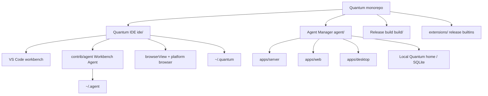

# Architecture overview

Quantum splits **in-editor** work from **multi-agent orchestration** while sharing principles: local data, MCP, and independent release paths.

## Topology



## Product boundaries

| Concern | Quantum IDE | Agent Manager |
| --- | --- | --- |
| Primary UX | Single editor + sidebar agent | Many parallel sessions / worktrees |
| Process model | Electron workbench + extension host | Server + web + optional Electron |
| Typical agent runtime | In-process extension + webview GUI | Codex app-server + WebSocket |
| Shared? | No code imports between `ide/` and `agent/` |

Both products may talk to the **same user-configured LLM endpoints** and **MCP servers**; they do not share a single cloud backend operated by Quantum.

## Workbench Agent vs Agent Manager

| | Workbench Agent | Agent Manager |
| --- | --- | --- |
| **Location** | `ide/src/vs/workbench/contrib/agent/` | `agent/` |
| **Shipped as** | Built into Quantum IDE | Standalone desktop app |
| **Best for** | Editing with AI beside the file | Parallel agents, Spaces, long-running orchestration |
| **Docs** | [Workbench Agent](../products/workbench-agent.md) | [Agent Manager](../products/agent-manager.md) |

They complement each other; neither replaces the other.

## Release build (`build/`)

Daily IDE development uses **`ide/`** (`npm run compile`, `./scripts/code.sh`).

**`build/`** produces branded Quantum binaries from pinned upstream VS Code:

```bash
cd build && ./dev/build.sh      # compile
cd build && ./dev/build.sh -p   # package
```

See [`build/docs/howto-build.md`](../../build/docs/howto-build.md).

## Core invariants

1. **Client-side data isolation** — [Privacy and data](privacy-and-data.md)
2. **MCP for tools** — [MCP](mcp.md)
3. **Decoupled packaging** — separate toolchains (gulp/Electron vs Bun/Effect)

## See also

- [Monorepo map](../reference/monorepo-map.md)
- [Documentation index](../readme.md)
