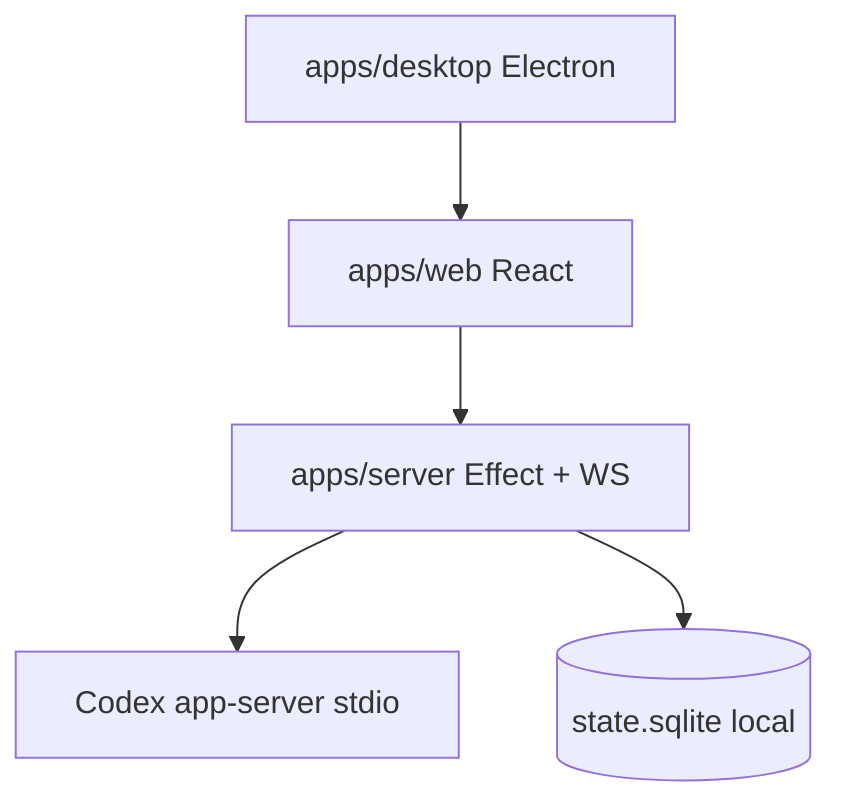

# Quantum Agent Manager

**Agent Manager** is a desktop workspace for orchestrating **parallel AI coding agents** — multi-model chats, Spaces, Activity, git worktrees, terminals, browser previews, and MCP-native tooling.

**Path:** [`agent/`](../../agent/)  
**Human README:** [`agent/README.md`](../../agent/README.md)

## What it is

| Component | Path | Role |
| --- | --- | --- |
| **Server** | `agent/apps/server/` | Effect-TS orchestration, WebSocket API, Codex app-server bridge |
| **Web UI** | `agent/apps/web/` | React / Vite — sessions, timeline, Spaces |
| **Desktop** | `agent/apps/desktop/` | Electron shell |
| **Contracts** | `agent/packages/contracts/` | Shared Effect schemas (protocol, events, types) |
| **Shared** | `agent/packages/shared/` | Runtime utilities (subpath exports) |



## Capabilities

- **Spaces & Activity** — spatial organization and live task feed
- **Multi-provider orchestration** — Codex, Claude, Cursor, Grok, Pi, and more (provider-dependent)
- **Parallel worktrees** — isolated git checkouts per thread
- **Unified workspace** — chat, terminal, diff, browser, PR-oriented flows
- **MCP** — tools and resources via Model Context Protocol
- **Private by design** — state and credentials in local Quantum data directory

## Getting started

```bash
# Monorepo (recommended)
./scripts/setup.sh --skip-ide

# Product only
cd agent && ./scripts/setup.sh
bun run dev
```

Desktop: `bun run dev:desktop` or `bun run dev` from `agent/` (see [`agent/README.md`](../../agent/README.md)).

## Prerequisites

- Bun ≥ 1.3.9
- Node.js ≥ 24

## Related docs

- [Agent Manager development](agent-manager-development.md)
- [Architecture overview](../architecture/overview.md)
- [MCP](../architecture/mcp.md)

## License

MIT — see [`agent/LICENSE`](../../agent/LICENSE).
