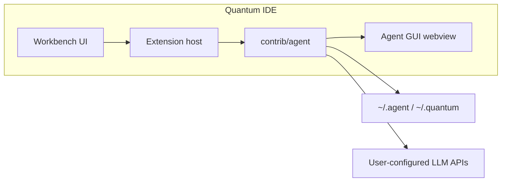

# Quantum IDE

**Quantum IDE** is an MIT-licensed, AI-native code editor — a fork of [Visual Studio Code](https://github.com/microsoft/vscode) with a **first-party workbench agent** and an embedded browser that can attach live page context to chat.

**Path:** [`ide/`](../../ide/)  
**Human README:** [`ide/README.md`](../../ide/README.md)

## What it is

| Layer | Description |
| --- | --- |
| **Workbench** | Full VS Code heritage: editing, terminal, debug, Git, search, extensions |
| **Workbench Agent** | Built-in AI sidebar, tools, MCP, apply/diff, tab autocomplete — [`contrib/agent`](../../ide/src/vs/workbench/contrib/agent/) |
| **Browser** | `browserView` + element picker; agent browser tools |
| **Extensions** | Open VSX; Microsoft telemetry removed at source |

User data directory: **`~/.quantum`** (see `ide/product.json` for product-specific names in dev).

## AI Architecture: First-Party Agent Subsystem

Quantum IDE integrates a custom, first-party agent architecture designed specifically for local-first, autonomous engineering workflows:

- **Quantum Workbench Agent ([`ide/src/vs/workbench/contrib/agent/`](../../ide/src/vs/workbench/contrib/agent/)):**
  The sole engine powering all AI capabilities across Quantum IDE. This includes conversational chat, inline code generation and refactoring, multi-file editing, tab autocomplete, plan and to-do execution, Model Context Protocol (MCP) clients, and automated browser tools. It is built into the workbench and runs in a per-window native worker.

- **Upstream VS Code Copilot Infrastructure (Unused):**
  The repository maintains an upstream Visual Studio Code codebase fork. Directories inherited from upstream Microsoft Copilot integrations — including `src/vs/workbench/contrib/chat/`, `src/vs/workbench/contrib/inlineChat/`, `src/vs/sessions/`, and `src/vs/platform/chat/` — are dormant upstream artifacts and are not utilized by Quantum IDE.

> [!IMPORTANT]
> **Implementation Boundary:**
> All AI features, model integrations, prompt engineering, agentic tools, context indexing, and chat interfaces must be implemented exclusively within [`ide/src/vs/workbench/contrib/agent/`](../../ide/src/vs/workbench/contrib/agent/). Do not extend, modify, or link against upstream Microsoft Copilot modules.

## High-level architecture

```
ide/
├── src/vs/workbench/contrib/agent/   # Workbench Agent (core, gui, native runtime)
├── src/vs/workbench/contrib/browserView/
├── src/vs/platform/browserView/      # Electron / CDP / Playwright stack
├── extensions/                       # Built-in extensions (dev compile)
├── build/gulpfile.agent.ts           # compile-agent / watch-agent
└── out/agent/                        # Generated native Agent runtime and GUI (not in git)
```



## Capabilities (product)

- **Agent sidebar** — chat, `@` context, `/` prompts, rules, skills (`.agents/skills/`)
- **Multi-provider models** — Anthropic, OpenAI, Gemini, Azure, Bedrock, Ollama, OpenRouter, Groq, xAI, DeepSeek, and more
- **Model roles** — chat, autocomplete, apply/edit, embeddings
- **Tools** — files, search, terminal, diffs; per-tool allow / ask / deny
- **MCP** — user-configured servers from Agent Settings
- **Plan mode & todos** — structured multi-step work in chat
- **Layouts** — Agent / Editor / Zen / Browser

## Related docs

- [IDE development](quantum-ide-development.md)
- [Workbench Agent](workbench-agent.md)
- [Architecture overview](../architecture/overview.md)

## Downloads

Installers: [GitHub Releases](https://github.com/Suryanshu-Nabheet/Quantum/releases/latest) (see [`ide/README.md`](../../ide/README.md) for platform assets).
