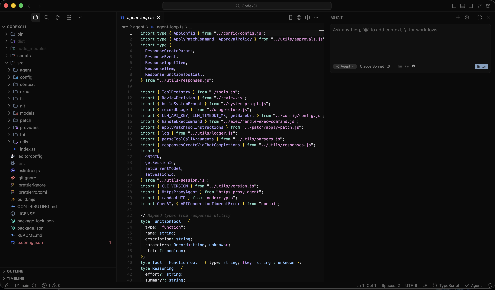
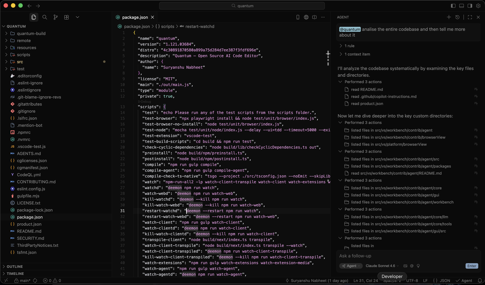
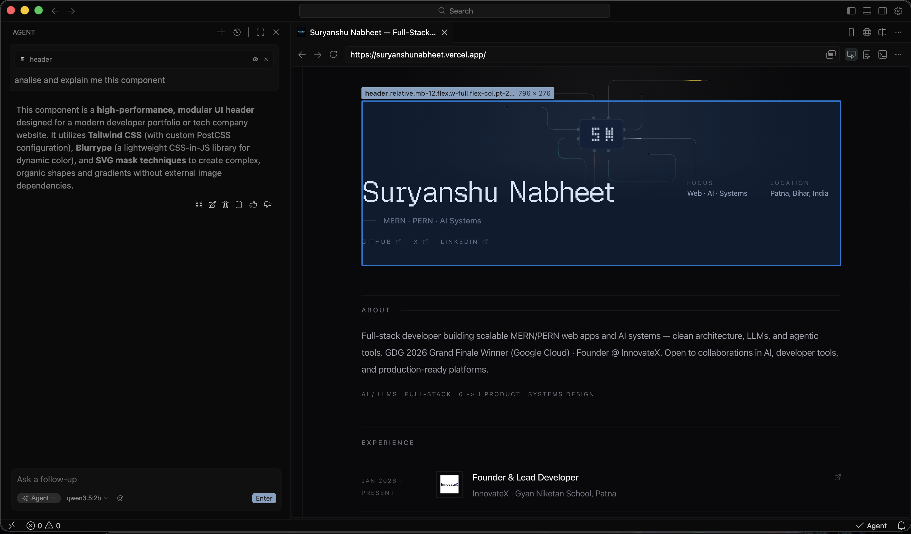
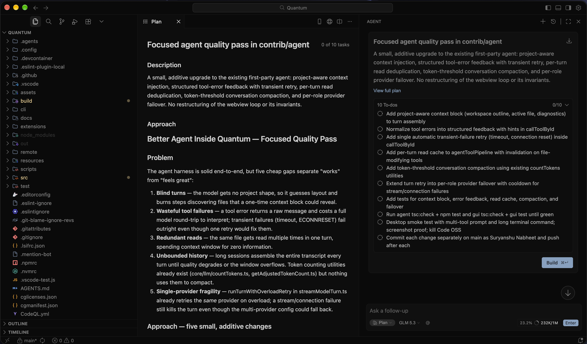
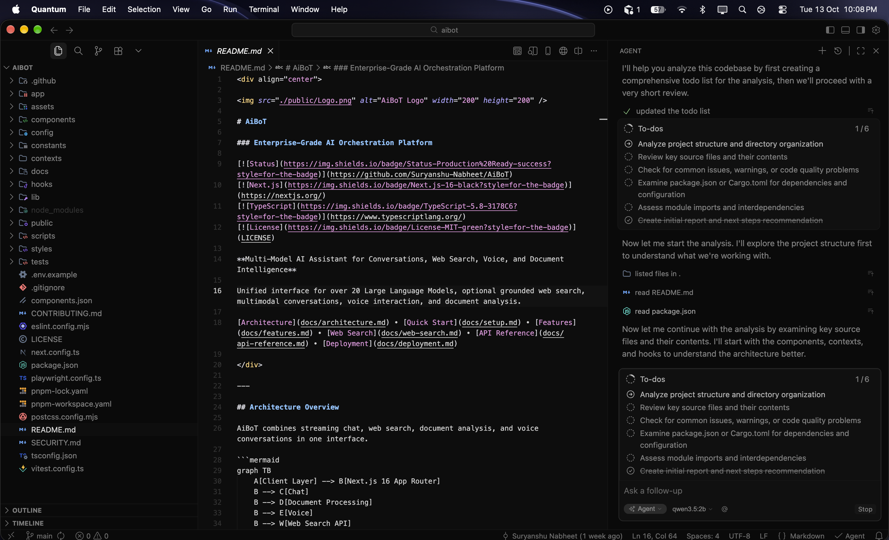
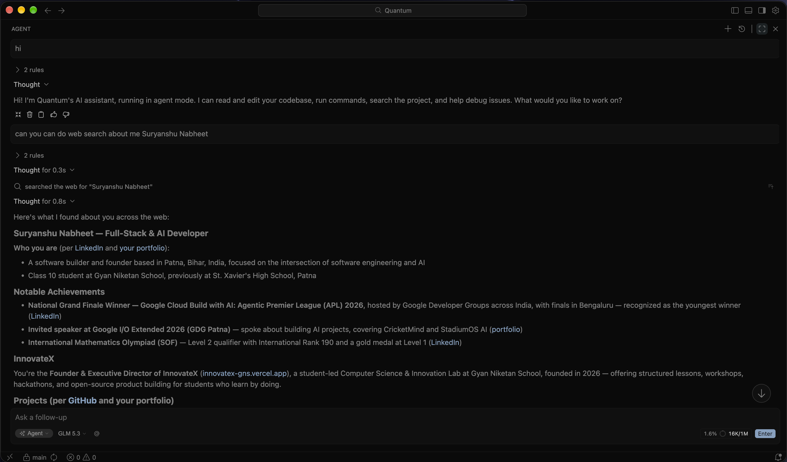

<p align="center">
  
</p>

# Quantum

[](https://github.com/Suryanshu-Nabheet/Quantum/issues?q=is%3Aopen+is%3Aissue+label%3Afeature-request+sort%3Areactions-%2B1-desc)
[](https://github.com/Suryanshu-Nabheet/Quantum/issues?q=is%3Aissue+is%3Aopen+label%3Abug)
[](https://github.com/Suryanshu-Nabheet/Quantum/blob/main/LICENSE.txt)
[](https://github.com/Suryanshu-Nabheet/Quantum)

[](https://github.com/Suryanshu-Nabheet/Quantum/releases/latest)

**Quantum is an AI-powered coding agent, code editor, and development environment built on a Visual Studio Code foundation.** It brings the editor, terminal, debugger, source control, integrated browser, and Quantum Agent together in one desktop application.

Quantum is open source and licensed under the [MIT License](LICENSE.txt).

<p align="center">
  
</p>

## Explore Quantum

<table>
  <tr>
    <td width="50%" valign="top">
      <h3>Work in your codebase</h3>
      <p>Ask the Agent to inspect, explain, and modify your project with the active workspace and relevant files in context.</p>
      
    </td>
    <td width="50%" valign="top">
      <h3>Connect the browser to your work</h3>
      <p>Use the integrated browser and element picker to give the Agent direct page context for debugging and implementation.</p>
      
    </td>
  </tr>
  <tr>
    <td width="50%" valign="top">
      <h3>Plan Mode</h3>
      <p>Plan Mode helps you organize and break down complex tasks with the Agent. It allows the Agent to generate step-by-step plans for your goals, making it easier to tackle large code changes or debugging sessions by providing a clear summary and actionable checklist.</p>
      
    </td>
    <td width="50%" valign="top">
      <h3>Agent to-do list</h3>
      <p>Work through complex tasks with the built-in AI-powered to-do list. Track, edit, and collaborate on steps with the agent as you go.</p>
      
    </td>
  </tr>
  <tr>
    <td width="50%" valign="top">
      <h3>Web search</h3>
      <p>Search the web from the Agent and use source links to investigate a question.</p>
      
    </td>
    <td width="50%"></td>
  </tr>
</table>

---

## What’s inside

- **A complete development environment** with code editing, search, Git, debugging, integrated terminals, and extensions from [Open VSX](https://open-vsx.org).
- **Quantum Agent** for understanding a project, planning work, editing files, running tools, and reviewing changes. Configure model providers, permissions, rules, prompts, and MCP servers in Settings.
- **Inline editing and autocomplete** to work with AI directly in the editor.
- **An integrated browser** with an element picker and tools that give the Agent context from pages you choose to share.

See the [documentation](docs/README.md) for setup, Agent workflows, architecture, and development.

## Downloads

The release workflow builds packages for the platforms below. Check the release page for available assets:

**[Download the latest Quantum release](https://github.com/Suryanshu-Nabheet/Quantum/releases/latest)**

| Platform | Asset |
|----------|--------|
| macOS Apple Silicon | `Quantum-darwin-arm64-*.zip` |
| Windows x64 | `Quantum-win32-x64-*.zip` |
| Linux x64 | `Quantum-linux-x64-*.tar.gz` (+ `.deb` when available) |

For an unsigned macOS build, use **Open** from the app’s context menu on the first launch.

## Build from source

Use Node.js **22.22.1**, npm, Python, and the native build tools for your platform. The [development guide](docs/development.md) covers prerequisites, checks, and troubleshooting.

```bash
git clone https://github.com/Suryanshu-Nabheet/Quantum.git
cd Quantum
./scripts/setup.sh
```

On Windows, run `scripts\setup.bat`. For subsequent launches, use `./scripts/setup.sh --launch-only` after a successful build.

## Documentation

- [Getting started](docs/getting-started.md)
- [Editor and workspace](docs/editor.md)
- [Quantum Agent](docs/agent.md)
- [Integrated browser](docs/browser.md)
- [Troubleshooting](docs/troubleshooting.md)
- [Architecture](docs/architecture.md)
- [Development and verification](docs/development.md)
- [Contributing](CONTRIBUTING.md)

## Contributing

- [Submit bugs and feature requests](https://github.com/Suryanshu-Nabheet/Quantum/issues)
- Review [pull requests](https://github.com/Suryanshu-Nabheet/Quantum/pulls)
- See [CONTRIBUTING.md](CONTRIBUTING.md)

## License

Copyright (c) 2026 Suryanshu Nabheet
Copyright (c) 2015-present Microsoft Corporation

Licensed under the **[MIT](LICENSE.txt)** license.

Derived from [Visual Studio Code](https://github.com/microsoft/vscode) (also MIT). Third-party notices: [ThirdPartyNotices.txt](ThirdPartyNotices.txt).
